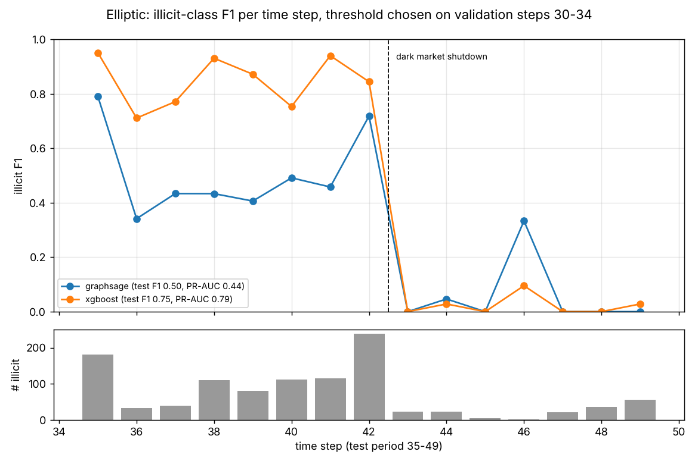
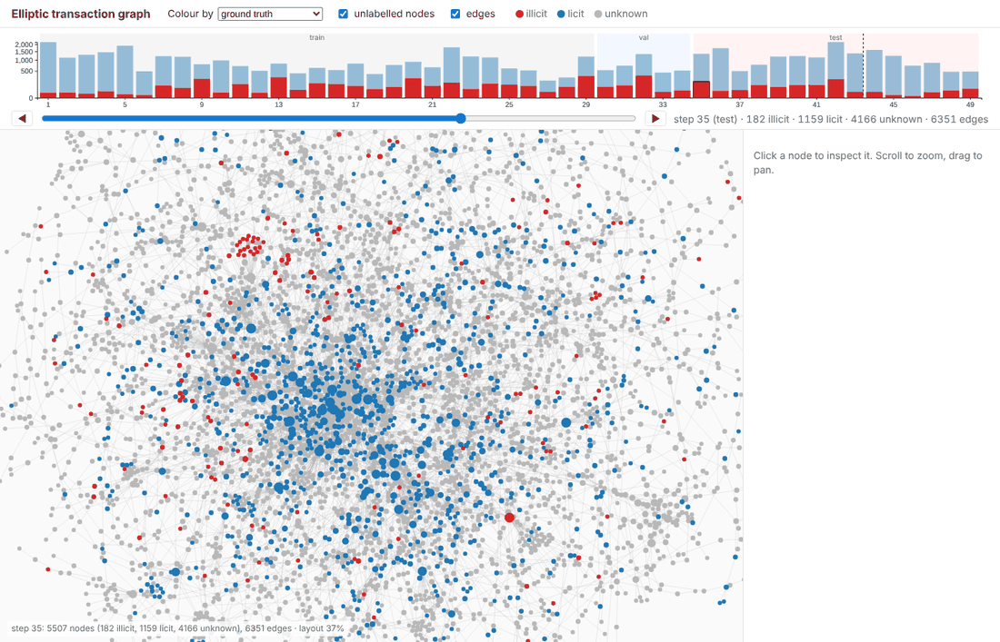
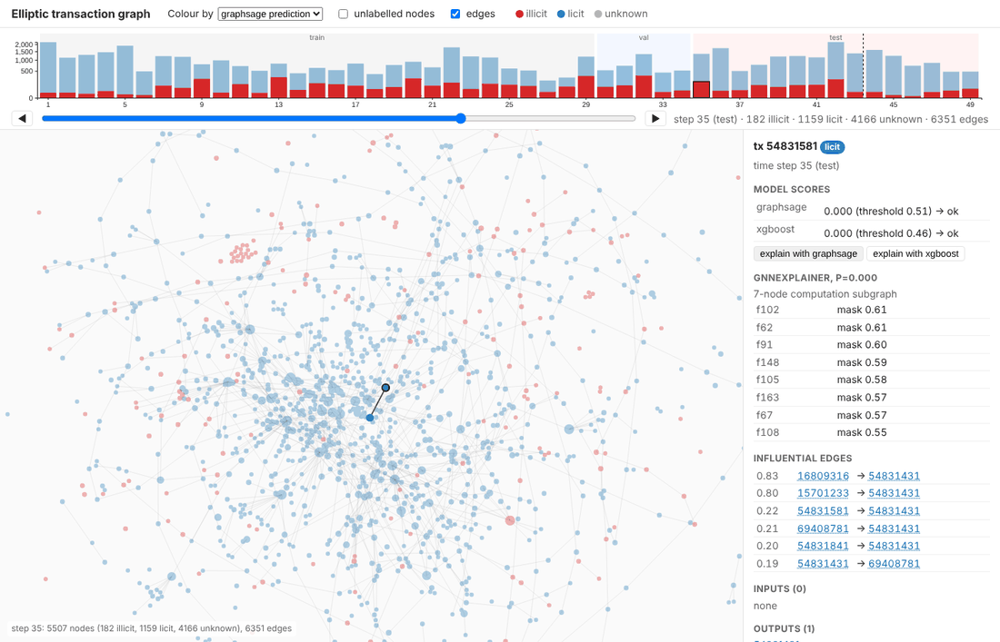

# graph-fraud-sagemaker

Graph-ML demo for anti-fraud: **GraphSAGE on DGL** vs. a **gradient-boosting baseline** on the
Elliptic Bitcoin dataset, trained and served on **Amazon SageMaker** (training job, 4-step
Pipeline, real-time endpoint), infrastructure in **CloudFormation**, explained with **SHAP**
and **GNNExplainer**. CI runs the linter, the tests (with real DGL) and `cfn-lint`.

[](https://github.com/artiz/az-fraud-detecion/actions/workflows/ci.yml)

## Results (test period, time steps 35–49)

Elliptic protocol: 49 time steps, train on 1–29, validate on 30–34, test on 35–49. Nothing is
tuned on the test period: early stopping and the decision threshold use the validation steps.

| Model | Features | Illicit F1 | Precision | Recall | PR-AUC | ROC-AUC | Train time (4 vCPU) |
|---|---|---|---|---|---|---|---|
| XGBoost (no graph) | 165 node features | **0.754** | 0.776 | 0.734 | **0.790** | 0.919 | 4 s |
| GraphSAGE (DGL, 2 layers, neighbour sampling 15/10) | 165 node features + payment graph | 0.503 | 0.518 | 0.489 | 0.439 | 0.861 | 281 s (26 epochs, early stopped) |



What the numbers say, honestly:

* Boosting on the hand-crafted 165 features is the stronger model, which matches the original
  Elliptic paper (Weber et al. 2019: RF 0.79 F1 vs. GCN 0.63). The aggregated features
  (columns 94–165) already summarise the 1-hop neighbourhood, so the graph adds little on top.
* Both models collapse after step 43 (dark-market shutdown): the illicit pattern changes and no
  model trained before it recovers. This is the regression every production fraud model has to be
  monitored for, which is why per-time-step F1 is tracked and plotted, not only the aggregate.
* GraphSAGE reaches 0.95 PR-AUC on validation and 0.44 on test, boosting 0.99 and 0.79: the GNN
  overfits the training-period graph structure more than the tabular model does. Known remedies,
  not implemented here: GNN embeddings as extra features for boosting (the paper's best variant),
  stronger regularisation, local-features-only input (`data.feature_set: local`).

Reproduce locally (≈ 6 minutes on a laptop CPU, 700 MB download on first run):

```bash
micromamba create -y -f environment.yml && micromamba activate graph-fraud
make data baseline gnn evaluate explain plot
```

## Architecture

```
                      ┌──────────────────────────── CloudFormation: infra.yaml ───────────────────────────┐
                      │  S3 bucket · ECR repo · SageMaker execution role · Model Package Group            │
                      └────────────────────────────────────────────────────────────────────────────────────┘
 Elliptic CSVs ──► S3 ──► [1 PrepareData] ──► parquet ──► [2 TrainModel] ──► model.tar.gz ──► [3 EvaluateModel]
                          ScriptProcessor              Estimator (custom       (S3)             ScriptProcessor
                          scripts/prepare_data.py      DGL image)                               scripts/evaluate.py
                                                       scripts/train.py                              │ evaluation.json
                                                                                                     ▼
                                                                          [4 CheckPrAuc] ── PR-AUC ≥ MinPrAuc ──► RegisterModel
                                                                                 │ else                              (Model Registry)
                                                                                 ▼                                       │
                                                                             FailStep                                    ▼
                      ┌──────────────── CloudFormation: endpoint.yaml ───────────────┐   model.tar.gz + image URI
                      │  SageMaker Model → EndpointConfig → Endpoint (ml.m5.large)   │ ◄──────────────────────────
                      │  POST /invocations  {nodes, edges, targets} → {scores, flags}│
                      └──────────────────────────────────────────────────────────────┘
   Kafka consumer / analyst agent (roadmap) ──► 2-hop neighbourhood of a transaction ──► endpoint ──► GNNExplainer / SHAP
```

One container image (`aws/docker/Dockerfile`) serves all four roles: processing, training,
evaluation and hosting. It is built from conda-forge with micromamba because DGL has no pip
source any more (see *Version compatibility*).

## Repository layout

```
configs/default.yaml        all hyperparameters and the time split; overridable from the CLI / SageMaker
src/graph_fraud/
  data.py                   download, clean, time-based split, parquet tables
  graph.py                  DGL graph construction, feature scaler
  baseline.py               XGBoost (native Booster API, early stopping on PR-AUC)
  gnn.py                    GraphSAGE, mini-batch training with NeighborSampler, early stopping
  metrics.py                illicit F1 / PR-AUC / per-time-step F1, threshold selection
  explain.py                SHAP TreeExplainer + DGL GNNExplainer
  inference.py, payload.py  endpoint request/response contract and k-hop payload builder
  artifacts.py              model.tar.gz layout shared by train / evaluate / serve / explain
scripts/                    prepare_data.py · train.py · evaluate.py · explain.py · serve.py · plot_results.py
ui/                         app.py (FastAPI + JSON API) · static/ (timeline + canvas graph, d3)
aws/                        pipeline.py · run_training_job.py · invoke_endpoint.py · upload_data.py · docker/
cloudformation/             infra.yaml (bucket, ECR, IAM, registry) · endpoint.yaml (model, config, endpoint)
tests/                      synthetic Elliptic-shaped graph; runs the full chain in ~40 s
.github/workflows/ci.yml    ruff · pytest with DGL (micromamba) · pipeline definition (moto) · cfn-lint · docker build
```

## Evening 1: model locally

```bash
python scripts/prepare_data.py --raw-dir data/raw --out-dir data/processed   # downloads from the PyG mirror
python scripts/train.py --model xgboost   --data-dir data/processed --model-dir artifacts/xgboost
python scripts/train.py --model graphsage --data-dir data/processed --model-dir artifacts/graphsage
python scripts/train.py --model graphsage --graphsage.epochs 5 --graphsage.hidden_dim 64   # any config key
```

Design decisions worth knowing:

* **Split by time, not at random.** Every edge in Elliptic connects two transactions of the same
  time step, so the 49 steps are disconnected snapshots. `build_tables` asserts this; it means
  full-graph training with a loss mask is exactly inductive training on the train period and the
  test period is unreachable by message passing (`tests/test_graph.py`).
* **Unknown-label nodes stay in the graph** for message passing but never enter a loss or metric.
* **Threshold** is the F1-optimal cut on validation and travels inside the model artifact, so the
  endpoint returns the same flag the evaluation measured.
* **GraphSAGE forward** accepts either sampled blocks or a full graph with optional edge weights,
  so the same module trains with neighbour sampling, scores exactly on the full graph, and is
  explainable by GNNExplainer without a wrapper. `tests/test_models.py` pins sampled == full-graph.

## Graph explorer UI

```bash
pip install fastapi uvicorn      # once; not part of the conda env
make ui                          # http://localhost:8050
```



* **Timeline** over the 49 time steps: licit (blue) and illicit (red) counts per step, train /
  val / test shading, the dark-market shutdown marker after step 43. Click a bar, drag the
  slider or use the arrow keys to switch steps.
* **Graph of the selected step** (force layout on canvas, up to ~8k nodes): red illicit, blue
  licit, grey unlabelled; node size follows degree. Zoom with the wheel, pan by dragging, hover
  for the transaction id and model scores. "Colour by" switches from ground truth to the
  prediction of any model found under `artifacts/` (flag at the stored threshold).
* **Node panel**: scores of every loaded model, in/out neighbours (clickable), largest features,
  and on-demand explanations: SHAP for XGBoost, GNNExplainer for GraphSAGE with the
  influential edges listed and clickable.



The UI is a FastAPI app (`ui/app.py`) over the processed parquet tables; the JSON API
(`/api/meta`, `/api/graph/{step}`, `/api/node/{tx}`, `/api/explain/{tx}?model=`) is covered by
`tests/test_ui_api.py`. Scores for all 200k nodes are computed once at start-up (about 3 s).

## Evening 2: SageMaker and CloudFormation

```bash
pip install -r requirements-aws.txt
export AWS_REGION=eu-central-1

# 1. long-lived, near-free infrastructure
aws cloudformation deploy --stack-name graph-fraud-infra --template-file cloudformation/infra.yaml \
    --capabilities CAPABILITY_NAMED_IAM
./aws/build_and_push.sh graph-fraud-infra            # builds the DGL image, pushes to the stack's ECR repo
python aws/upload_data.py --raw-dir data/raw          # raw CSVs -> s3://<bucket>/elliptic/raw/

# 2. a single training job on the same script (model.tar.gz lands in s3://<bucket>/models/)
aws s3 sync data/processed s3://$(aws cloudformation describe-stacks --stack-name graph-fraud-infra \
    --query "Stacks[0].Outputs[?OutputKey=='BucketName'].OutputValue" --output text)/elliptic/processed/
python aws/run_training_job.py --model graphsage --data-s3-uri s3://<bucket>/elliptic/processed/ --wait

# 3. the 4-step pipeline: prepare -> train -> evaluate -> register if PR-AUC >= MinPrAuc
python aws/pipeline.py --definition-only | head -50   # inspect the JSON first
python aws/pipeline.py --upsert --start               # parameters: ModelType, Epochs, MinPrAuc, instance types

# 4. endpoint from the trained artifact, one test call, then delete the stack
aws cloudformation deploy --stack-name graph-fraud-endpoint --template-file cloudformation/endpoint.yaml \
    --parameter-overrides ModelDataUrl=s3://<bucket>/models/<job>/output/model.tar.gz \
                          ImageUri=<account>.dkr.ecr.eu-central-1.amazonaws.com/graph-fraud:latest
python aws/invoke_endpoint.py --endpoint-name graph-fraud-endpoint --tx-id 70335036 --tx-id 94067451
aws cloudformation delete-stack --stack-name graph-fraud-endpoint      # do this right away
```

The endpoint request carries the transaction's 2-hop neighbourhood (`graph_fraud.payload.build_request`
assembles it from the parquet tables; in production a graph store or the Kafka consumer would).
Response: per-target illicit probability and the flag at the stored threshold.

Pipeline step contracts (all in the custom image):

| Step | Script | Input | Output |
|---|---|---|---|
| PrepareData (Processing) | `scripts/prepare_data.py` | raw CSVs from S3 | `nodes.parquet`, `edges.parquet`, `meta.json` |
| TrainModel (Training) | `scripts/train.py` | channel `data` | `model.tar.gz` (model + scaler + threshold + config), CloudWatch metrics `test:pr_auc`, `test:f1` |
| EvaluateModel (Processing) | `scripts/evaluate.py` | `model.tar.gz`, parquet | `evaluation.json` in SageMaker model-quality layout |
| CheckPrAuc (Condition) | | `binary_classification_metrics.pr_auc.value` | RegisterModel (PendingManualApproval, metrics attached) or FailStep |

The pipeline definition is built offline in CI against moto (`tests/test_pipeline_definition.py`), so
SageMaker SDK API drift is caught before anything runs in the account.

## Evening 3: explainability and tooling

```bash
python scripts/explain.py --model-dir artifacts/xgboost   --data-dir data/processed --out artifacts/xgboost/explanations.json
python scripts/explain.py --model-dir artifacts/graphsage --data-dir data/processed --out artifacts/graphsage/explanations.json --tx-id 96939427
```

* **SHAP TreeExplainer** on the booster: global importance (mean |SHAP|) and, per transaction, the
  top features with sign; the SHAP values sum back to the model's logit (tested). On the test
  period the dominant features are `f52`, `f58`, `f124`, `f89`, `f57` (Elliptic does not publish
  feature semantics, so the report stays at column level).
* **GNNExplainer** (DGL) on GraphSAGE: learns a feature mask and an edge mask on the node's
  2-hop computation subgraph. The report lists top features, top edges with original transaction
  ids and neighbour labels, so an analyst sees *which counterparties* pushed the score. Example from
  the real run: illicit transaction `96939427` (step 40), probability 1.00, explained by features
  `f147`, `f105` and the payment to `96564983` (edge weight 0.95).
* Both explainers return plain JSON, ready for the analyst-facing agent on the roadmap.

CI (`.github/workflows/ci.yml`): `ruff check` + `ruff format --check`, `pytest` inside a
micromamba environment with real DGL, the pipeline definition test with moto, `cfn-lint` on both
templates, and a Docker build of the SageMaker image with a smoke test on PRs and `main`.

## Version compatibility (checked 2026-11-21)

| Component | Pin | Why |
|---|---|---|
| DGL | 2.3.0 (conda-forge) | Last DGL release is 2.4.0 (Sept 2024). The project's wheel index `data.dgl.ai` no longer answers and the `dgl.ai` domain has lapsed, so pip cannot install DGL at all; conda-forge still ships 2.3.0 for Python 3.9–3.12, CPU and CUDA 11.8/12.0. |
| PyTorch | 2.3.1 | DGL 2.3 links against libtorch 2.3; nothing newer loads. Conda-forge builds use the C++11 ABI, so the pip PyTorch wheel does *not* work with the conda DGL build. Take both from conda-forge. |
| torchdata | ≥0.7, <0.10 | DGL 2.3 imports `torchdata.datapipes`, removed in torchdata 0.10. |
| Python | 3.12 | Upper bound of the conda-forge DGL build. |
| glibc ≥ 2.41 hosts | run `scripts/fix_execstack.sh` | conda-forge `libtorch_cpu.so` 2.3.1 carries an executable-stack flag that glibc 2.41+ refuses to load (`import torch` fails). The script clears the flag with patchelf; CI and the Docker image run it automatically. |
| XGBoost / SHAP / scikit-learn | 2.1 / 0.48 / 1.9 | The native `Booster` API is used instead of the sklearn wrapper, whose `save_model` broke with scikit-learn ≥ 1.6. |
| SageMaker Python SDK | ≥2.230, <3 | v3 (late 2025) replaced Estimator/Pipelines APIs; this repo targets v2 and the test suite pins the generated pipeline definition. |
| AWS GraphStorm | 0.5 | Pins the same PyTorch 2.3 / DGL 2.3 pair in its SageMaker image, so this environment is GraphStorm-ready. |

## Cost

Everything except the endpoint is pay-per-use and idles at a few cents per month (S3 + ECR storage).
Approximate eu-central-1 on-demand prices (check the SageMaker pricing page before quoting them):

| Item | Instance | Duration | Cost |
|---|---|---|---|
| PrepareData | ml.m5.xlarge (€0.27/h) | ~5 min | €0.03 |
| TrainModel GraphSAGE | ml.m5.2xlarge (€0.54/h) | ~10 min incl. startup | €0.09 |
| EvaluateModel | ml.m5.xlarge | ~5 min | €0.03 |
| Endpoint test | ml.m5.large (€0.13/h) | 20 min | €0.05 |
| Endpoint **left running** | ml.m5.large | 24 h | **€3.20** |
| Full pipeline run | | | **≈ €0.15** |

The endpoint is the only resource with a running meter: it lives in its own stack so that
`aws cloudformation delete-stack --stack-name graph-fraud-endpoint` is the last command of every
session. S3 lifecycle rules expire model artifacts after 60 days; ECR keeps the last 5 images.

## Roadmap (optional, the remaining two scale points)

* **Kafka consumer** that assembles a transaction's neighbourhood from a graph store and scores it
  through the endpoint (`graph_fraud.payload` already defines the request).
* **Analyst agent** that turns `explanations.json` into a narrative for one transaction.
* **GraphStorm** run of the same node-classification task, same environment pins.
* GNN embeddings + boosting hybrid, the strongest configuration reported on Elliptic.

## References

* Weber et al., *Anti-Money Laundering in Bitcoin: Experimenting with Graph Convolutional Networks
  for Financial Forensics*, KDD Workshop 2019 (the Elliptic dataset paper).
* Hamilton, Ying, Leskovec, *Inductive Representation Learning on Large Graphs* (GraphSAGE), 2017.
* Ying et al., *GNNExplainer: Generating Explanations for Graph Neural Networks*, 2019.
* Dataset: Kaggle `ellipticco/elliptic-data-set`, mirrored at `data.pyg.org/datasets/elliptic/`.
